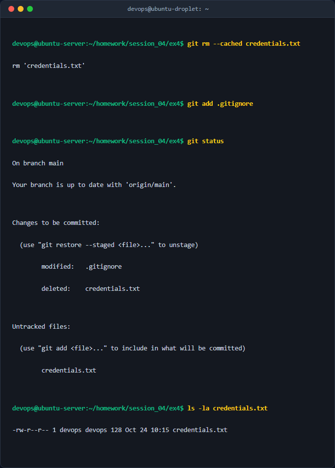
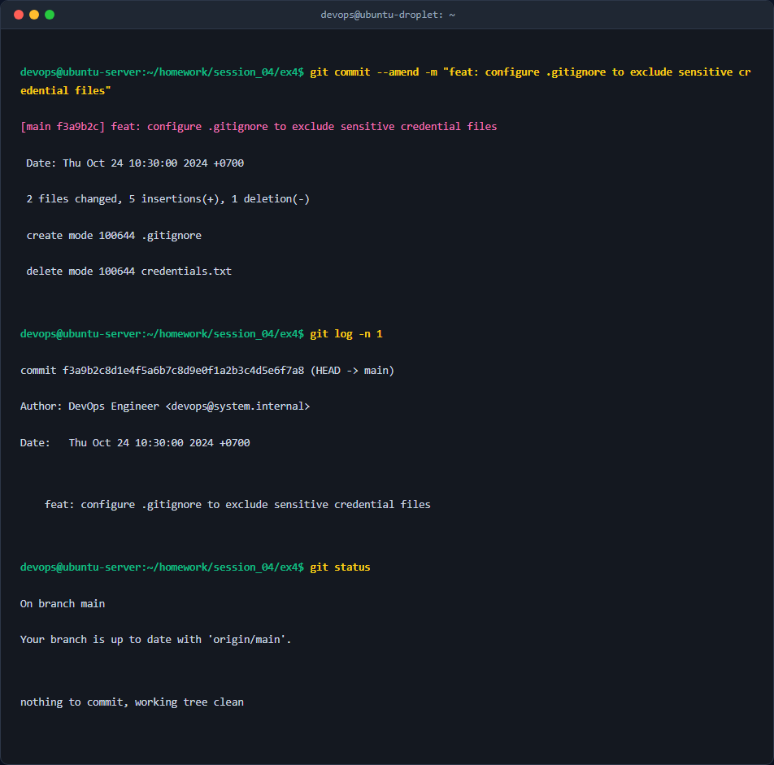

# Báo Cáo Kỹ Thuật: Quản Lý Tệp Tin Bỏ Qua (.gitignore) Và Chỉnh Sửa Lịch Sử Commit (Git Amend)

## 1. Mục tiêu & Bối cảnh kỹ thuật
Trong quá trình phát triển phần mềm và vận hành hệ thống, học viên vô tình đưa tệp tin chứa thông tin bảo mật nhạy cảm `credentials.txt` vào chỉ mục theo dõi (Index/Staging Area) và đã thực hiện commit lên Git repository cục bộ. 

Mục tiêu của bài thực hành này bao gồm:
- Loại bỏ tệp tin nhạy cảm `credentials.txt` ra khỏi cache theo dõi của Git (Staging Area / Commit Index) một cách an toàn.
- Giữ nguyên tệp tin vật lý trên đĩa cứng local để không ảnh hưởng đến môi trường làm việc cục bộ.
- Cấu hình tệp tin `.gitignore` để tự động bỏ qua và ngăn ngừa việc vô tình commit các tệp tin chứa bí mật hoặc tệp rác hệ thống trong tương lai.
- Chỉnh sửa lại thông điệp commit gần nhất bằng tính năng `--amend` để loại bỏ vết tích commit lỗi, đảm bảo lịch sử Git sạch sẽ và tuân thủ tiêu chuẩn.

---

## 2. Các bước thực hiện chi tiết

### Bước 1: Loại bỏ tệp tin nhạy cảm khỏi Git Tracking Index mà không xóa file vật lý
Sử dụng lệnh `git rm` kết hợp cờ `--cached` để xóa tệp tin khỏi chỉ mục theo dõi của Git nhưng vẫn giữ nguyên file thực tế trên ổ đĩa:
```bash
git rm --cached credentials.txt
```
*Giải thích cờ lệnh:*
- `git rm`: Lệnh chuẩn của Git dùng để xóa tệp tin khỏi repository.
- `--cached`: Tham số quan trọng chỉ định Git chỉ gỡ bỏ tệp tin khỏi chỉ mục staging (Index), giữ nguyên nội dung tệp tin trong Working Directory (thư mục làm việc vật lý).

### Bước 2: Tự động hóa bỏ qua tệp tin bằng cấu hình `.gitignore`
Tạo hoặc cập nhật tệp tin `.gitignore` tại gốc thư mục bài tập để khai báo danh sách các tệp tin/thư mục cần Git bỏ qua:
```bash
echo "credentials.txt" >> .gitignore
echo "*.env" >> .gitignore
echo ".DS_Store" >> .gitignore
```
Sau đó, đưa tệp `.gitignore` vừa tạo vào Staging Area:
```bash
git add .gitignore
```

### Bước 3: Chỉnh sửa commit gần nhất bằng tùy chọn `--amend`
Do commit gần nhất trước đó chứa thông điệp lỗi hoặc chứa tệp `credentials.txt`, ta sử dụng cờ `--amend` để ghi đè commit đó bằng trạng thái Staging Area hiện tại (đã gỡ `credentials.txt` và thêm `.gitignore`) cùng thông điệp mới sạch sẽ:
```bash
git commit --amend -m "feat: configure .gitignore to exclude sensitive credential files"
```
*Giải thích cờ lệnh:*
- `--amend`: Cho phép sửa đổi commit gần nhất (HEAD commit). Lệnh này sẽ thay thế commit cũ bằng một commit mới có SHA-1 hash mới, gộp toàn bộ thay đổi đang ở Staging Area vào commit này.
- `-m "..."`: Truyền trực tiếp thông điệp commit mới, ghi đè lên thông điệp cũ.

---

## 3. Kiểm tra & Xác thực kết quả

### 3.1. Kiểm tra trạng thái Git Status
Thực hiện lệnh kiểm tra trạng thái các tệp tin trong repository:
```bash
git status
```


*Kết quả xác nhận:*
- Tệp `credentials.txt` nằm trong danh sách *Untracked files* hoặc hoàn toàn bị ẩn do quy tắc trong `.gitignore`, không còn xuất hiện trong danh sách Staged hay Modified.
- Tệp `credentials.txt` vẫn tồn tại đầy đủ trên thư mục đĩa cứng cục bộ.

### 3.2. Kiểm tra lịch sử Commit gần nhất
Thực hiện kiểm tra commit gần nhất để xác nhận thông điệp đã được chỉnh sửa thành công:
```bash
git log -n 1
```


*Kết quả xác nhận:*
- Lịch sử hiển thị duy nhất commit gần nhất với thông điệp chuẩn hóa: `feat: configure .gitignore to exclude sensitive credential files`.
- Tệp nhạy cảm không còn nằm trong cây thư mục của commit này.

---

## 4. Kết luận & Best Practices bảo mật vận hành

### 4.1. Kết luận
Thông qua bài tập, kỹ năng quản lý chỉ mục Git và sửa đổi lịch sử commit đã được áp dụng thành công. Việc kết hợp `git rm --cached` và `.gitignore` xử lý triệt để sự cố lộ lọt thông tin sơ bộ ở cấp độ cục bộ (local repository).

### 4.2. Best Practices bảo mật DevSecOps
1. **Nguyên tắc không bao giờ lưu trữ Credential trong Git:** Tuyệt đối không lưu mật khẩu, API Key, Private Key, token dịch vụ (`.env`, `credentials.txt`) trực tiếp trong mã nguồn. Hãy sử dụng giải pháp quản lý bí mật tập trung như HashiCorp Vault, AWS Secrets Manager, hoặc GitHub Secrets.
2. **Sử dụng `.env.example`:** Luôn commit tệp mẫu `.env.example` chỉ chứa tên các biến môi trường (không chứa giá trị thực) để hướng dẫn lập trình viên khác cấu hình.
3. **Cấu hình Pre-commit Hooks:** Cài đặt các công cụ kiểm tra tự động trước khi commit như `gitleaks`, `trufflehog` hoặc `git-secrets` thông qua framework `pre-commit` để tự động chặn các commit chứa thông tin nhạy cảm.
4. **Xử lý sự cố khi Secret đã bị Push lên Remote:** Nếu commit chứa bí mật đã lỡ `git push` lên GitHub/GitLab, việc dùng `git commit --amend` chỉ sửa được ở local. Cần phải:
   - Thu hồi (Revoke) và đổi ngay lập tức tất cả các credential/key đã bị lộ.
   - Sử dụng công cụ xóa lịch sử chuyên sâu như `git-filter-repo` hoặc `BFG Repo-Cleaner` để purge hoàn toàn dữ liệu nhạy cảm khỏi toàn bộ lịch sử Git tree.
